# kwibaka-boardgame-platform

[](https://github.com/kwibaka-games/boardgame-platform/actions/workflows/ci.yml)

A small self-hosted web board-game platform for a campus/friends group.
Platform and game processes are isolated; each room gets its own game worker
process, and each game implementation is versioned in its own git repository.

[中文文档](docs/zh-CN/) · [English docs](docs/en/) · [AGPL-3.0-only](LICENSE)

## Features

- Email registration, email verification, password login, unique UUID accounts.
- Profile page: visible-ASCII username, avatar, email change with re-verification.
- Lobby, rules modal, password-protected rooms, ready state, host-only start,
  kick before start, and one-click restart after a finished match.
- Public room chat and spectator mode; hidden-information games can disable
  spectator chat.
- Waiting rooms are closed automatically if a game has not started within 15
  minutes (`ROOM_WAIT_TIMEOUT_MS`).
- Wins-per-game statistics and an administrator area (search, ban/unban,
  force-rename).
- Per-viewer game protocol; the platform routes views and never receives a full
  game state.
- One worker process per match; a crash aborts only that room.
- 《冰冷的她醒来之前》 standard (`ice`) and chaos (`ice-chaos`) rules with
  private views, simultaneous choices, server-side decision timeouts, card art,
  and a browser UI.
- Reversi / 黑白棋: host chooses black or white before start, per-player move
  hints, live disc counts, resignation, pass handling, and spectator chat.
- 阿尔林铎棋 / Alendo: triangular-board Othello from Hypergryph's
  《来自星尘》; 96-triangle board, six centre pieces, forced legal-move hints,
  live counts, resignation, and spectator chat.
- 五子棋 / Gomoku:
  - 11×11 free-style, no forbidden moves, black first; a full-board draw is a
    white win.
  - 15×15 free-style comet-seki setup (black H8, white J7, black F10), white
    first; a full-board draw is a loss for both.
  - 15×15 specified-opening forbidden mode: black-only overline/double-four/
    double-three forbidden points with a black-only hint toggle.
  - 15×15 RIF: specified opening, black forbidden points, three-move swap and
    five-move two choices.
  - Coordinates skip I (A-H, J-P). Free/seki have no hint UI.
- 亚马逊棋 / Amazons: 10×10 cell board, four pieces per side, queen-like move
  followed by a queen-like arrow shot; forced movement/arrow targets; a side
  with no legal turn loses.
- 爱因斯坦棋 / Einstein chess: 5×5 numbered pieces, system 1D6, closest-number
  move (tie -> lower), forced target display, corner/capture-all win.
- 红色的门和杀人鬼的钥匙 / Red Gate: 3–8 player hidden-role card game with
  numbered doors, silver keys, deception, 22 optional expansion cards, and
  spectator/mute chat restrictions.
- Mock tic-tac-toe worker as the reference implementation.
- Self-contained FontAwesome Free assets, no CDN dependency.

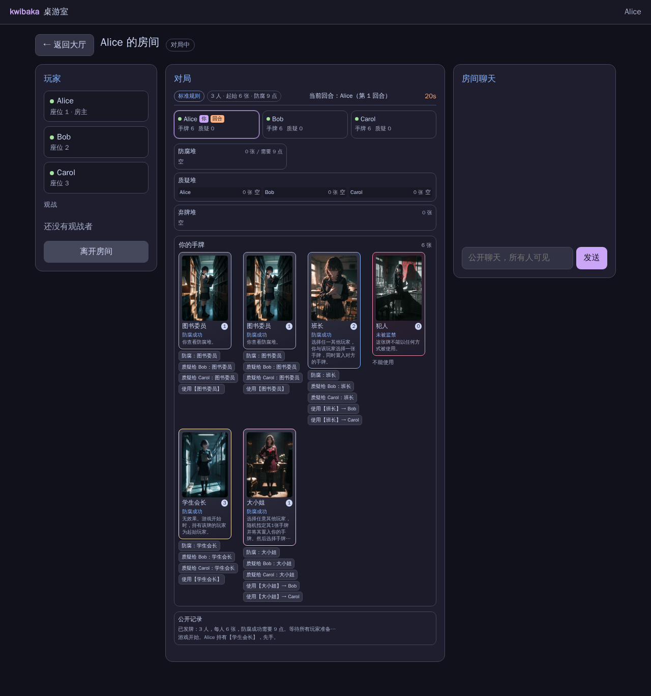

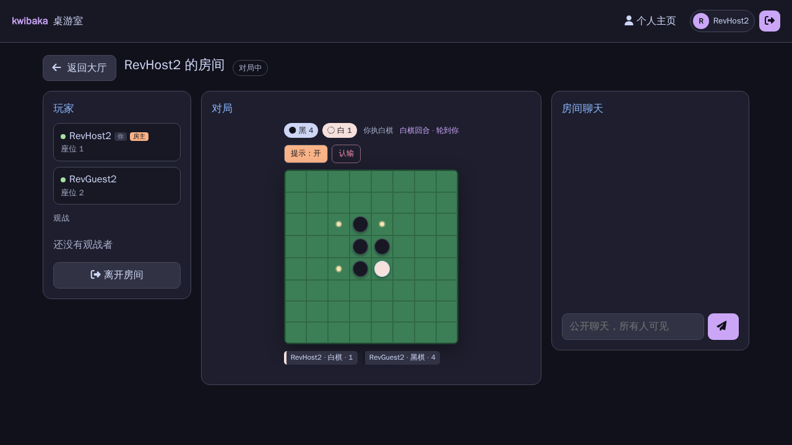

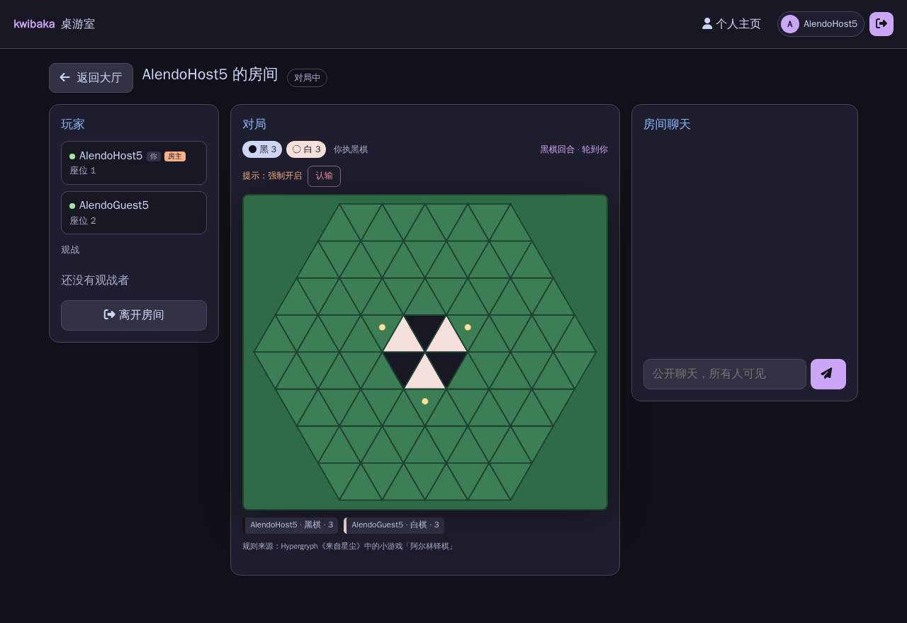

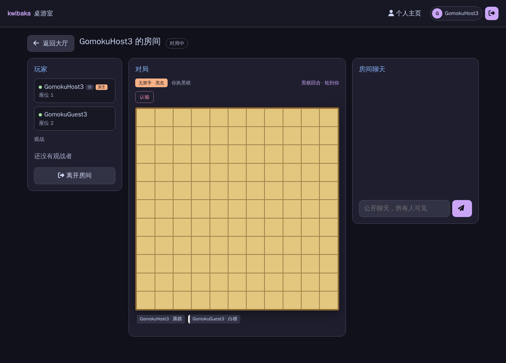

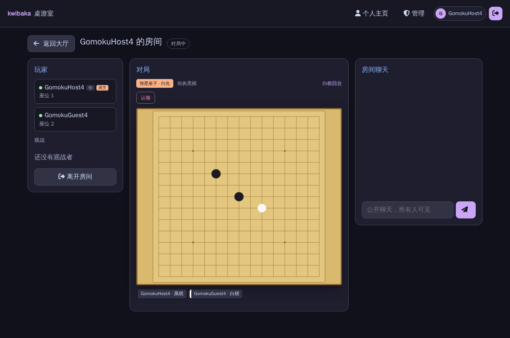

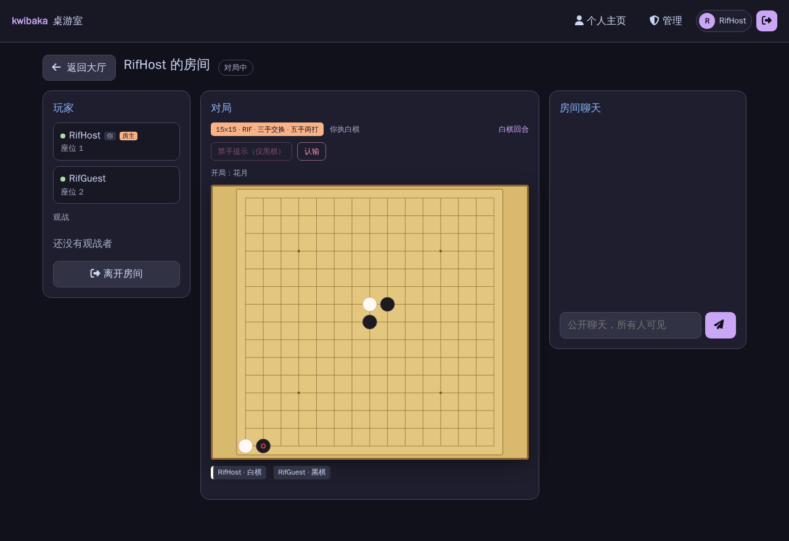

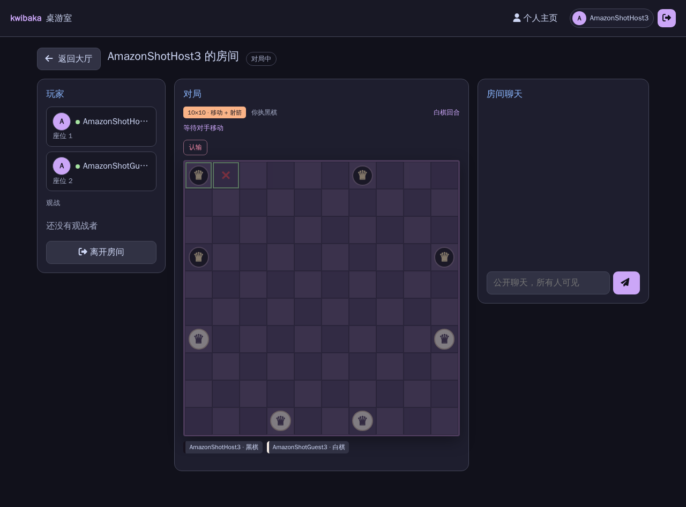

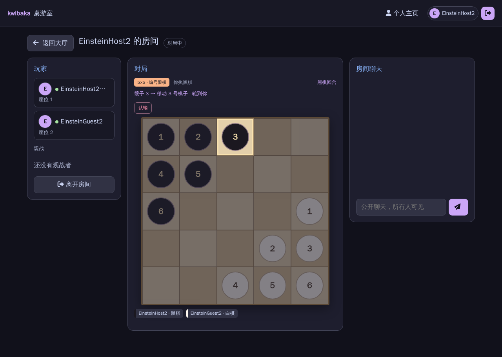

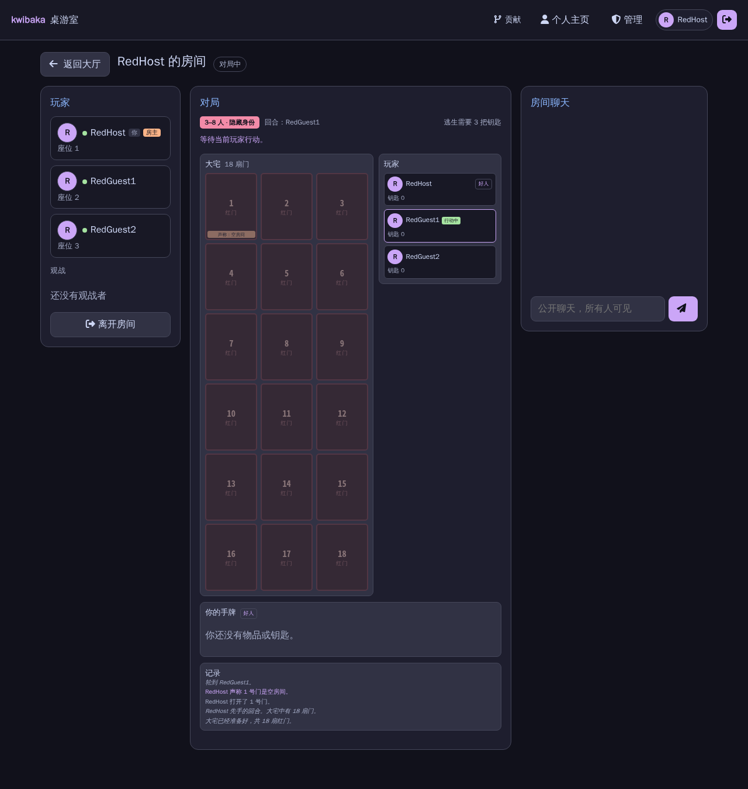

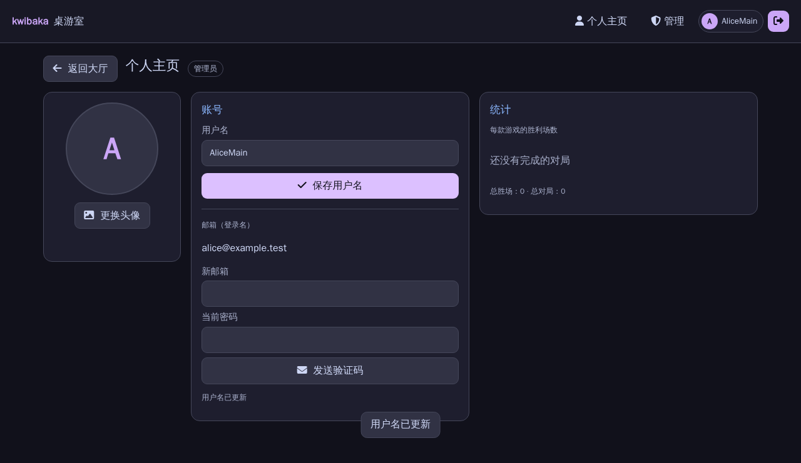

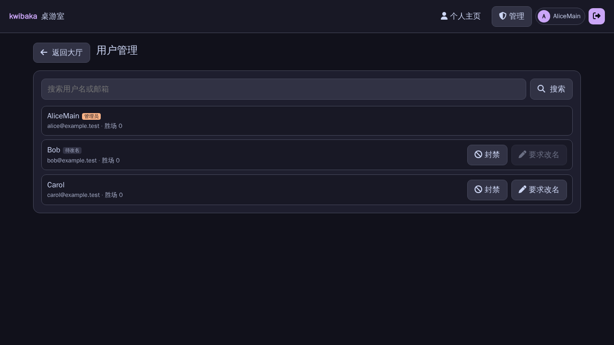

## Architecture

```text
browser
  | HTTPS / Socket.IO
Caddy or another reverse proxy
  |
platform (Node/TypeScript, SQLite)
  | WebSocket JSON protocol v1
  +-- game worker process (one per room/match)
```

The platform owns accounts, rooms, chat, readiness, statistics, and routing.
Game workers own rules and state. A game worker sends `view` messages only with
an explicit `to` target.

## Repository layout

```text
src/platform/        HTTP, Socket.IO, SQLite, auth, rooms, worker management
src/protocol/        shared protocol v1 types and zod validation
src/games/ice/       git submodule: before-she-rises repository
src/games/mock/      git submodule: mock-ttt repository
src/games/reversi/   git submodule: reversi repository
src/games/alendo/    git submodule: alendo repository
src/games/gomoku/    git submodule: gomoku repository (four catalog ids)
src/games/amazons/   git submodule: amazons repository
src/games/einstein/  git submodule: einstein repository
src/games/red-gate/  git submodule: red-gate repository
src/cli/             administrator bootstrap CLI
web/                 platform shell, styles, rules pages, generated game UI
scripts/             sync-games and ice fuzzer
tests/               accounts, platform, mock, ice engine/integration tests
deploy/              Docker Compose, Caddyfile, environment example
docs/                zh-CN/en deployment, interface, and testing guides
```

Game submodules are the source of truth for both rules and browser modules.
`npm run sync-games` copies `src/games/<name>/web/*` into the gitignored
`web/games/` tree.

## Quick start

```bash
git clone --recurse-submodules https://github.com/kwibaka-games/boardgame-platform.git
cd kwibaka-boardgame-platform
npm install

# local testing without SMTP: verification code is shown in the UI/log
EMAIL_DEBUG=1 PORT=8080 DB_PATH="$PWD/data/dev.db" npm run dev:platform
```

Open `http://127.0.0.1:8080`, register an email, and verify it. There are no
seeded accounts. The first verified account becomes administrator unless
`ADMIN_EMAIL` reserves that role for a specific email.

For a real deployment with Docker and Caddy:

```bash
cp deploy/.env.example deploy/.env
chmod 600 deploy/.env
# edit deploy/.env, including GAME_SECRET and SMTP settings
docker compose -f deploy/docker-compose.yml --profile edge up -d --build
```

See [Deployment](docs/en/deployment.md) / [部署](docs/zh-CN/deployment.md) for
TLS, SMTP, backups, first-admin bootstrap, and upgrades.

## Tests

```bash
git submodule update --init --recursive
npm ci
npm run sync-games
npm test                 # accounts, platform, mock, ice
npm run build
npm run fuzz:ice -- 1000
```

See [Testing](docs/en/testing.md) / [测试](docs/zh-CN/testing.md).

## Adding a game

A game repository is mounted at `src/games/<name>` and contains its worker,
metadata, browser module, and optional card assets. The host registers it in
`src/platform/game-catalog.ts`; the shared protocol is at
`src/protocol/protocol.ts` (relative import `../../protocol/protocol.js`).
See the [interface guide](docs/en/interfaces.md) for the protocol and module
contract.

## Security

- Never commit `deploy/.env`, SMTP credentials, certificates, databases, or logs.
- Use `COOKIE_SECURE=1` and HTTPS in production.
- Keep `EMAIL_DEBUG=0` on a public deployment.
- Do not expose the platform or worker ports directly; only the reverse proxy.
- Back up the SQLite database and certificate separately.

## Contributing

See [CONTRIBUTES.md](CONTRIBUTES.md). Platform changes go to this repository; game
changes go to the corresponding game repository; new games are added as git
submodules.

## License

AGPL-3.0-only. See [LICENSE](LICENSE).
